# Pip — The Skull Baby
## System Architecture

### 1. Project Overview

Pip — The Skull Baby is a creative, interactive character portfolio for the Baby's First Website hackathon.

Pip is a gentle, sleepy skull baby who works as a Junior Dream Engineer at the Midnight Nursery. The website combines a nostalgic early-web aesthetic with playful interactions, storytelling, animations, audio, mini-games, and advanced interactive features.

**Architecture status:** Proposed design. Actual implementation details must be verified against the code generated by Arena AI.

### 2. Architecture Goals

- Deliver a polished, responsive character portfolio.
- Support interactive storytelling and scroll-based scenes.
- Provide engaging audio, animation, and mini-game experiences.
- Support optional 3D character rendering and AI-powered conversation.
- Store guestbook entries and shared visit counts securely.
- Separate frontend code, backend operations, database access, and private secrets.
- Maintain source history through Git and GitHub.
- Build, test, and deploy through a suitable hosting provider.

### 3. System Architecture Diagram

The diagram below represents the proposed end-to-end system, from visitor interactions to frontend features, backend services, AI integration, security controls, testing, and deployment.

**Diagram file:** `docs/images/architecture.png`

### 4. Technology Stack

| Layer | Planned technology | Purpose |
|---|---|---|
| AI-assisted development | Arena AI | Generate and refine the frontend |
| Frontend | React and Vite, if supported by generated code | Application structure and development build |
| Styling | CSS and responsive layouts | Visual design and mobile support |
| Graphics | SVG, CSS animations, optional Three.js | Character effects, illustrations, and 3D |
| Browser APIs | Web Audio API, localStorage, Intersection Observer | Audio, preferences, and scroll interactions |
| Backend | Supabase | Backend services and database |
| Database protection | Supabase Row Level Security (RLS) | Restrict database access |
| AI integration | Server-side function and external AI provider | Secure character chat |
| Source control | Git and GitHub | Version history and source hosting |
| Website hosting | Vercel or Netlify | Production website deployment |
| Quality checks | Functional tests, responsive checks, Lighthouse | Reliability and performance |

The exact framework, hosting provider, and service configuration will be confirmed after inspecting the generated project.

### 5. Frontend Architecture

The frontend is responsible for the visual experience and visitor interactions.

#### Tier 1 — Core Experience

- Pip's introduction and character presentation.
- At least three dream-related projects.
- Origin story and scroll-driven storytelling.
- Cursor eye tracking and hover reactions.
- Day/night theme toggle.
- Hidden Easter egg.
- Responsive desktop, tablet, and mobile layouts.

#### Tier 2 — Advanced Interactions

- Lullaby or music-box audio using the Web Audio API.
- Flashlight cursor effect.
- Animated dream-delivery route.
- Interactive dream flipbook.
- Dream-catching mini-game.

#### Tier 3 — Advanced Features

- Three.js 3D Pip character.
- Character AI chat interface.
- Live guestbook.
- Visitor memory experience.
- Lighthouse performance target of 90 or higher, where achievable.

#### Optional Side Quests

- Sparkle cursor trail.
- Hit counter.
- Click sounds with a mute toggle.
- Responsive chaos mode.
- Other eligible features confirmed by the official hackathon rules.

### 6. Client-Side Logic

The browser manages interface state, interactions, visual effects, and local preferences.

- **UI state:** Controls interactive components and interface states.
- **Scroll observer:** Triggers story scenes and route animations.
- **Animation controls:** Coordinate motion and respect reduced-motion preferences.
- **Web Audio API:** Handles audio effects and music-box playback.
- **Three.js/WebGL:** Renders the optional 3D character.
- **localStorage:** Stores non-sensitive preferences, such as theme or audio settings.
- **Form validation:** Provides immediate feedback before guestbook submission.
- **Static assets:** Contains approved character artwork, SVGs, and other local assets.

Persistent visitor memory is optional and must use data minimization, appropriate access restrictions, and clear privacy controls.

### 7. Backend and Database Architecture

Supabase is the planned backend for features requiring shared or persistent data.

#### Guestbook

The guestbook interface submits a message to the backend. The backend validates the data, and database policies determine whether the operation is permitted.

#### Shared Hit Counter

The website may record visits through a protected backend operation. A shared counter must not rely solely on a client-side value.

#### Visitor Memory

Persistent visitor memory is optional. If implemented, it must have a clear purpose, appropriate access restrictions, and privacy controls.

#### Authentication

Authentication should be introduced only if the final feature design requires it. Public guestbook functionality must not expose private database privileges.

### 8. AI Chat Architecture

The character chat must not send private provider credentials directly from browser code.

Planned request flow:

1. The visitor sends a message through Pip's chat interface.
2. The frontend submits the request to a trusted server-side function.
3. The server validates the request and applies suitable abuse protections.
4. The server uses a privately stored provider credential to contact the AI service.
5. The response is checked and safely returned to the frontend.
6. The chat interface displays the response.

The server-side function may use Supabase Edge Functions or another suitable server-side runtime. The AI provider, model, usage limits, and costs must be confirmed before implementation.

### 9. Security and Privacy

- Never expose service-role keys, secret API keys, or private credentials in frontend code.
- Store server-side secrets in the backend or deployment provider's secret configuration.
- Use only publishable frontend keys intended for browser use.
- Configure Supabase Row Level Security policies before enabling public database access.
- Validate user input on the server as well as the client.
- Apply appropriate rate limits and abuse protection to public endpoints.
- Restrict guestbook operations to the minimum permissions required.
- Avoid collecting unnecessary visitor information.
- Do not store sensitive visitor data in localStorage.
- Treat user-generated text and AI responses as untrusted input.
- Never commit secrets, private environment files, or credentials to a public GitHub repository.

### 10. Source Control, Build, Testing, and Deployment

#### Source Control

Git manages local version history. GitHub stores the repository and its committed source files.

Changes should be grouped into meaningful milestones with descriptive commit messages and working checkpoints.

#### Build and Testing

Before deployment, verify that:

- The production build completes successfully.
- Navigation and interactive features work.
- Backend operations enforce their intended permissions.
- The website works on mobile and desktop.
- Audio controls, mute settings, and reduced-motion preferences behave correctly.
- The hidden Easter egg and mini-game function as intended.
- Accessibility and performance issues are reviewed.

#### Deployment

Vercel or Netlify will host the production website after the generated framework and build settings are confirmed.

Environment variables must be configured in the appropriate hosting or backend settings. A successful build does not by itself prove that every feature works correctly.

### 11. Architecture Principles

1. **Progressive implementation:** Build and verify core features before adding complex systems.
2. **Separation of concerns:** Keep interface, browser logic, backend operations, and AI integration clearly separated.
3. **Security by design:** Apply least privilege, server-side validation, and safe secret handling.
4. **Responsive by default:** Design for mobile and desktop from the beginning.
5. **Performance awareness:** Optimize images, animation, loading behavior, and optional 3D features.
6. **Accessible interactions:** Support keyboard access, readable contrast, audio controls, and reduced motion.
7. **Honest implementation status:** Clearly distinguish planned features from completed and tested features.

### 12. Implementation Status

This document describes the proposed architecture, not proof that every feature has already been built.

After inspecting the actual generated project, update the technology stack and architecture to reflect what exists in the codebase. Mark a feature complete only after it has been implemented and tested.

### 13. References

- Product requirements: `PRD.md`
- Technical requirements: `TRD.md`
- Project overview and setup: `README.md`
- Architecture diagram: `docs/images/architecture.svg`

---

## Mermaid Source

The source below can be pasted into Mermaid Live Editor to regenerate the architecture diagram.

```mermaid
flowchart TB
    USER["Visitor<br/>Desktop • Tablet • Mobile"]

    subgraph FRONTEND["1. FRONTEND — ARENA AI GENERATED WEBSITE"]
        APP["Pip Portfolio Application"]

        subgraph CORE["Tier 1 — Core Experience"]
            HERO["Pip Character & Introduction"]
            PROJECTS["Three Dream Projects"]
            ORIGIN["Origin Story & Scroll Scenes"]
            EYES["Cursor Eye Tracking & Hover Reactions"]
            THEME["Day / Night Toggle"]
            EGG["Hidden Easter Egg"]
            RESPONSIVE["Responsive Mobile Layout"]
        end

        subgraph ADVANCED["Tier 2 — Interactive Features"]
            AUDIO["Lullaby / Music Box"]
            FLASH["Flashlight Cursor Effect"]
            DREAMROUTE["Animated Dream Delivery Route"]
            FLIP["Interactive Dream Flipbook"]
            GAME["Dream Catching Mini-Game"]
        end

        subgraph BOSS["Tier 3 — Advanced Features"]
            THREE["Three.js 3D Pip Character"]
            CHATUI["Character AI Chat Interface"]
            GUESTUI["Live Guestbook Interface"]
            MEMORYUI["Visitor Memory Experience"]
            PERFORMANCE["Lighthouse Performance Target"]
        end

        subgraph SIDEQUESTS["Optional Side Quests"]
            SPARKLE["Sparkle Cursor Trail"]
            HITUI["Hit Counter Display"]
            CLICKS["Click Sounds + Mute Toggle"]
            CHAOS["Responsive Chaos Mode"]
        end
    end

    subgraph CLIENT["2. CLIENT-SIDE LOGIC & BROWSER APIs"]
        STATE["UI State & Interaction Manager"]
        SCROLL["Scroll / Intersection Observer"]
        MOTION["Animation & Reduced Motion Controls"]
        AUDIOAPI["Web Audio API"]
        GRAPHICS["WebGL / Three.js Renderer"]
        LOCAL["Local Storage<br/>Local Preferences & Optional Visitor Memory"]
        VALIDATE["Client-side Form Validation"]
        ASSETS["Character Images, SVGs & Static Assets"]
    end

    subgraph BACKEND["3. BACKEND — SUPABASE"]
        SUPACLIENT["Supabase Client Integration"]

        subgraph ACCESS["Access & Protection"]
            RLS["Row Level Security Policies"]
            RULES["Input Validation & Database Rules"]
            LIMIT["Abuse Protection / Rate Limiting<br/>Where Supported"]
        end

        subgraph SERVICES["Backend Capabilities"]
            GUESTSERVICE["Guestbook Operations"]
            COUNTSERVICE["Shared Hit Counter"]
            MEMORYSERVICE["Persistent Visitor Memory<br/>If Implemented"]
            AUTH["Authentication<br/>Only If Required"]
        end

        subgraph DATABASE["Supabase Database"]
            GUESTDB[("Guestbook Entries")]
            COUNTDB[("Shared Visit Count")]
            VISITORDB[("Optional Visitor Records")]
        end
    end

    subgraph AI_LAYER["4. AI INTEGRATION — PLANNED"]
        CHATREQUEST["Secure Chat Request"]
        SERVER["Trusted Server-side Function<br/>Supabase Edge Function or Equivalent"]
        MODEL["External AI Model API"]
        CHATRESPONSE["Validated Chat Response"]
    end

    subgraph SECURITY["5. SECURITY & PRIVACY"]
        ENV["Environment Variables"]
        SECRET["Private Secrets Kept Server-side"]
        PUBLICKEY["Frontend Publishable Key"]
        PRIVACY["Data Minimization & Visitor Consent"]
        SAFEOUTPUT["Safe Input / Output Handling"]
    end

    subgraph DELIVERY["6. SOURCE CONTROL, BUILD & DEPLOYMENT"]
        SOURCE["Local Project Files"]
        GIT["Git Version Control"]
        GITHUB["GitHub Repository"]
        BUILD["Build & Production Checks"]
        HOST["Vercel or Netlify Hosting"]
        LIVE["Live Pip Website"]
        TESTS["Functional, Mobile & Accessibility Tests"]
        LIGHTHOUSE["Lighthouse Audit"]
    end

    USER --> APP
    APP --> HERO
    APP --> PROJECTS
    APP --> ORIGIN
    APP --> EYES
    APP --> THEME
    APP --> EGG
    APP --> RESPONSIVE
    APP --> AUDIO
    APP --> FLASH
    APP --> DREAMROUTE
    APP --> FLIP
    APP --> GAME
    APP --> THREE
    APP --> CHATUI
    APP --> GUESTUI
    APP --> MEMORYUI
    APP --> PERFORMANCE
    APP --> SPARKLE
    APP --> HITUI
    APP --> CLICKS
    APP --> CHAOS

    HERO --> STATE
    PROJECTS --> STATE
    EGG --> STATE
    GAME --> STATE
    FLIP --> STATE
    ORIGIN --> SCROLL
    DREAMROUTE --> SCROLL
    THEME --> LOCAL
    MEMORYUI --> LOCAL
    AUDIO --> AUDIOAPI
    CLICKS --> AUDIOAPI
    THREE --> GRAPHICS
    FLASH --> MOTION
    SPARKLE --> MOTION
    CHAOS --> MOTION
    RESPONSIVE --> MOTION
    APP --> ASSETS
    GUESTUI --> VALIDATE
    CHATUI --> VALIDATE

    GUESTUI --> SUPACLIENT
    HITUI --> SUPACLIENT
    MEMORYUI -. "Optional persistent data" .-> SUPACLIENT
    SUPACLIENT --> RULES
    RULES --> RLS
    RLS --> GUESTSERVICE
    RLS --> COUNTSERVICE
    RLS --> MEMORYSERVICE
    GUESTSERVICE --> GUESTDB
    COUNTSERVICE --> COUNTDB
    MEMORYSERVICE --> VISITORDB
    AUTH -. "If needed" .-> SUPACLIENT
    LIMIT -. "Additional protection" .-> GUESTSERVICE
    LIMIT -. "Additional protection" .-> COUNTSERVICE

    CHATUI --> CHATREQUEST
    CHATREQUEST --> SERVER
    SERVER --> SAFEOUTPUT
    SAFEOUTPUT --> MODEL
    MODEL --> CHATRESPONSE
    CHATRESPONSE --> CHATUI

    ENV --> SECRET
    SECRET --> SERVER
    PUBLICKEY --> SUPACLIENT
    PRIVACY --> MEMORYSERVICE
    PRIVACY --> GUESTSERVICE
    SAFEOUTPUT --> CHATRESPONSE

    SOURCE --> GIT
    GIT --> GITHUB
    GITHUB --> BUILD
    BUILD --> TESTS
    TESTS --> LIGHTHOUSE
    LIGHTHOUSE --> HOST
    HOST --> LIVE
    LIVE --> USER
    LIGHTHOUSE -. "Optimization feedback" .-> PERFORMANCE

    classDef core fill:#dbeafe,stroke:#2563eb,color:#1e3a8a
    classDef tier2 fill:#fef3c7,stroke:#d97706,color:#78350f
    classDef tier3 fill:#ede9fe,stroke:#7c3aed,color:#4c1d95
    classDef side fill:#fce7f3,stroke:#db2777,color:#831843
    classDef backend fill:#dcfce7,stroke:#16a34a,color:#14532d
    classDef security fill:#fee2e2,stroke:#dc2626,color:#7f1d1d
    classDef deploy fill:#e5e7eb,stroke:#4b5563,color:#111827

    class HERO,PROJECTS,ORIGIN,EYES,THEME,EGG,RESPONSIVE core
    class AUDIO,FLASH,DREAMROUTE,FLIP,GAME tier2
    class THREE,CHATUI,GUESTUI,MEMORYUI,PERFORMANCE tier3
    class SPARKLE,HITUI,CLICKS,CHAOS side
    class SUPACLIENT,RLS,RULES,LIMIT,GUESTSERVICE,COUNTSERVICE,MEMORYSERVICE,AUTH,GUESTDB,COUNTDB,VISITORDB backend
    class ENV,SECRET,PUBLICKEY,PRIVACY,SAFEOUTPUT security
    class SOURCE,GIT,GITHUB,BUILD,HOST,LIVE,TESTS,LIGHTHOUSE deploy
```

